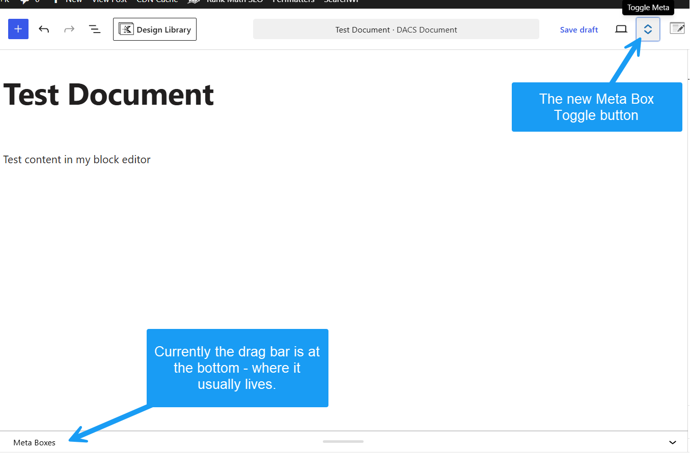
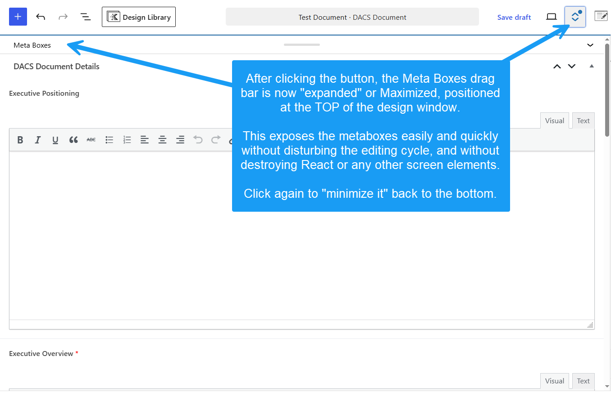

# Block Meta Toggle (`aplusplg-block-meta-toggle`)

A lightweight WordPress utility that adds a **Toggle Meta Boxes** button to the Block Editor toolbar. The button uses WordPress's existing meta-box collapse/expand control rather than imposing its own height rules. The native resize handle remains draggable, and WordPress retains the open panel height selected by the user.

The plugin does not relocate meta boxes, manipulate their visibility attributes, or intercept editor save behavior.

---

## Screenshots

*Figure 1: Double Vertical Arrows toggle injected into the top toolbar.*

*Figure 2: Expanded full-height meta box viewport.*

---

## Key Features

* **Zero DOM Relocation:** Keeps `#poststuff` and all meta fields in their native DOM location. Fully preserves ACF repeater fields, Select2 dropdowns, color pickers, and third-party JS listeners.
* **100% Core Save Compatible:** No hijacked submission handlers or broken auto-save states. Standard WordPress Update/Publish buttons handle all data seamlessly.
* **Native Resize Support:** The WordPress drag handle and resize state remain fully under WordPress control.
* **Two-State Toolbar Toggle:** Collapses the meta-box panel or reopens it at the height managed by WordPress.
* **Lightweight & Clean:** Class-based Singleton architecture with zero database settings or admin clutter.

---

## Installation

### As a Standard Plugin
1. Download or clone this repository.
2. Upload the `aplusplg-block-meta-toggle` directory to your site's `/wp-content/plugins/` folder.
3. Activate **Block Meta Toggle** via **Plugins > Installed Plugins** in the WordPress admin dashboard.

### As an MU-Plugin
Place the whole plugin directory in `/wp-content/mu-plugins/` and load the main PHP file from a small root-level MU loader. Do not copy just the PHP file: it requires its bundled JavaScript and CSS.

---

## How It Works

1. The plugin waits for the Block Editor's native meta-box expand/collapse control to be mounted.
2. It adds a **Toggle Meta Boxes** button to the editor toolbar.
3. Clicking the button activates WordPress's native panel control. The panel closes to its native minimum or reopens using WordPress's preferred height.
4. The native drag bar remains operable at all times. Dragging adjusts panel height without the plugin overriding that value.
5. Where WordPress provides no native resizable meta-box panel, no toggle is inserted.

---

## Requirements

* **WordPress:** 6.0+ (Tested up to 7.1)
* **PHP:** 7.4 or higher
* Compatible with Advanced Custom Fields (ACF), Rank Math, Yoast, and custom `add_meta_box()` calls.

---

## License

GPL-2.0-or-later — Free for personal and commercial use.
